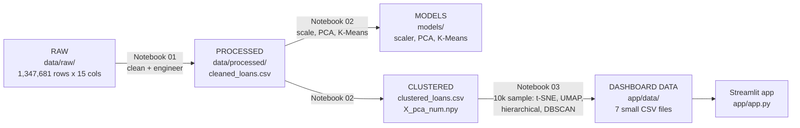

# Credit Portfolio Segmentation and Risk Pattern Analysis

Unsupervised learning project (GUVI x HCL) that groups loan borrowers by financial and credit profile, then compares historical default rates across the groups. The results are presented in an interactive Streamlit dashboard.

**Live dashboard:** _add your Streamlit link here after deploying_

## Problem statement
Financial institutions deal with borrowers who have different incomes, credit scores, employment histories and loan needs. This project uses clustering to find distinct borrower segments, profiles each segment, and compares historical default rates between segments. The `Default` column is **never** used to form the clusters. It is used only afterwards to compare outcomes.

## Dataset
- **Source:** `loans_granting_model_dataset.csv` (Lending Club loan data), provided with the GUVI project brief.
- **Size:** 1,347,681 loans, 15 columns, issued 2007-2018.
- **Used columns:** annual income (`revenue`), debt-to-income ratio (`dti_n`), loan amount, FICO score, employment length, loan purpose, home ownership, state, issue date, and `Default`.
- **Dropped:** `title`, `desc` (free text, mostly missing), `zip_code`, and `experience_c` (constant).
- The raw file is about 160 MB, so it is **not included** in this repository. Download it from the project brief and place it at `data/raw/loans_granting_model_dataset.csv`.

## Project structure
```
credit-portfolio-segmentation/
├── .streamlit/
│   └── config.toml            # light theme for the dashboard
├── app/
│   ├── app.py                 # Streamlit dashboard
│   ├── requirements.txt       # light requirements for deployment
│   └── data/                  # small summary files used by the dashboard
├── data/
│   ├── raw/                   # raw CSV (not tracked)
│   └── processed/             # cleaned and clustered data (not tracked)
├── models/                    # saved scaler, PCA and K-Means (not tracked)
├── notebooks/
│   ├── 01_cleaning_eda.ipynb
│   ├── 02_features_pca_kmeans.ipynb
│   └── 03_dimred_hierarchical_dbscan.ipynb
├── presentation/              # final presentation
├── reports/figures/           # saved plots
├── src/
│   ├── config.py              # paths, random seed, constants
│   └── preprocessing.py       # cleaning and feature functions
├── requirements.txt           # pinned requirements for the full project
└── README.md
```

## Data architecture

### Overview
The project turns one raw 160 MB CSV into a set of small, dashboard-ready files in four layers. Each layer is produced by a notebook and can be rebuilt from the layer before it.



### Folder map
```
data/
├── raw/          loans_granting_model_dataset.csv   source data, never edited     (not in Git)
└── processed/    cleaned_loans.csv                  after cleaning (17 columns)    (not in Git)
                  clustered_loans.csv                + kmeans_cluster (18 columns)  (not in Git)
                  X_pca_num.npy                      4 PCA components per borrower  (not in Git)
models/           scaler_num.pkl, pca_num.pkl,
                  kmeans_num.pkl                     fitted objects (seed 42)       (not in Git)
app/data/         7 summary CSV files                only data the dashboard reads  (in Git)
reports/figures/  PNG plots from the notebooks                                      (in Git)
```
Raw and processed files are over GitHub's 100 MB limit, so they are rebuilt locally instead of committed.

### Layer 1: raw data (`data/raw/`)
Lending Club loans issued June 2007 to December 2018. Columns are grouped here by how the project uses them.

| Role | Columns | How they are used |
|---|---|---|
| Clustering inputs | `revenue`, `dti_n`, `loan_amnt`, `fico_n`, `emp_length` | Cleaned, scaled and clustered. Income is log-transformed and employment length is converted to years. |
| Describing the segments | `purpose`, `home_ownership_n`, `addr_state`, `issue_d` | Used after clustering for segment profiles, state analysis and year trends. |
| Outcome | `Default` (0/1, 19.98% default rate) | Used only after clustering to compare default rates. |
| Dropped | `id`, `title`, `desc`, `zip_code`, `experience_c` | Identifier, free text, partial zip codes, and a constant column. |

### Layer 2: processed data (`data/processed/`)
| File | Size | What changed |
|---|---|---|
| `cleaned_loans.csv` | 1,347,681 x 17 | Adds `issue_year`, `issue_month`, `emp_length_years`, `emp_length_missing`, `revenue_log`, `purpose_grouped` |
| `X_pca_num.npy` | 1,347,681 x 4 | PCA scores of the five scaled numeric features, keeping 91.3% of the variance |
| `clustered_loans.csv` | 1,347,681 x 18 | Adds the final `kmeans_cluster` label |

### Layer 3: models (`models/`)
`scaler_num.pkl` (StandardScaler), `pca_num.pkl` (4 components) and `kmeans_num.pkl` (k = 4), saved with `joblib` so new borrowers can be assigned to a segment without refitting.

### Layer 4: dashboard data (`app/data/`)
The deployed app reads only these files. They hold group-level summaries and one anonymous sample, and contain no loan IDs.

| File | Used on dashboard page |
|---|---|
| `cluster_profile.csv` | Overview, Cluster profiles, Default analysis |
| `cluster_purpose.csv`, `cluster_ownership.csv` | Cluster profiles |
| `state_default.csv` | Default analysis (state chart) |
| `year_cluster_default.csv` | Default analysis (trend chart) |
| `algorithm_comparison.csv` | Algorithm comparison |
| `dashboard_sample.csv` (10,000 rows) | Visualizations, Anomalies |

### Data quality summary
| Check | Finding | Action |
|---|---|---|
| Duplicate rows | None | None needed |
| Missing values | None in numeric columns; `title` and `desc` have gaps (`desc` is 91% missing) | Both dropped |
| Employment length | 78,188 loans have value "NI" (no information) | Flagged in `emp_length_missing`, filled with the median |
| DTI outliers | 533 loans above 100, maximum 999 | Capped at the 99th percentile |
| Income outliers | Maximum 10.9M, heavy right skew | Capped at the 99th percentile, then log-transformed |
| Constant column | `experience_c` is 1 in all but 25 rows | Dropped |
| Rare loan purposes | 14 purposes, several under 1% of loans | Grouped into 8 categories (`purpose_grouped`) |

### Rebuild the data
1. Put the raw CSV in `data/raw/`.
2. Run notebook 01, then 02, then 03 in order.
3. The last cell of notebook 03 writes the seven files into `app/data/`.

### Data handling
- `Default` and `id` never enter the clustering features.
- Results describe groups of borrowers, not individuals.
- The random seed is 42 everywhere (`src/config.py`), so results are reproducible.

### `data/raw/`
Holds the original, unmodified dataset. It is never edited and never committed to GitHub (about 160 MB, over GitHub's 100 MB file limit).

| Column | Type | Used for | Notes |
|---|---|---|---|
| `id` | int | nothing | Loan identifier, dropped before clustering |
| `issue_d` | text (`Dec-2015`) | `issue_year`, `issue_month` | Range 2007-06 to 2018-12 |
| `revenue` | float | `revenue_log` | Annual income, heavily skewed, capped at the 99th percentile |
| `dti_n` | float | clustering | Debt-to-income ratio, capped at the 99th percentile (max in raw data is 999) |
| `loan_amnt` | int | clustering | Loan amount, 0 to 40,000 |
| `fico_n` | float | clustering | FICO credit score, about 600 to 847 |
| `experience_c` | int | dropped | Constant (1,347,656 rows are 1) |
| `emp_length` | text | `emp_length_years` | "NI" (no information) is flagged and filled with the median |
| `purpose` | text | profiling | 14 categories, rare ones grouped into `purpose_grouped` |
| `home_ownership_n` | text | profiling | MORTGAGE, RENT, OWN, OTHER |
| `addr_state` | text | geographic analysis | 51 states |
| `zip_code` | text | dropped | Partial zip codes (for example `190xx`) |
| `Default` | 0/1 | post-clustering only | Default rate 19.98%, never a clustering feature |
| `title`, `desc` | text | dropped | Free text, `desc` is 91% missing |

### `data/processed/`
Created by the notebooks, so it can always be rebuilt. It is git-ignored.

| File | Shape | Created by | Contents |
|---|---|---|---|
| `cleaned_loans.csv` | 1,347,681 x 17 | Notebook 01 | Raw columns kept plus `issue_year`, `issue_month`, `emp_length_years`, `emp_length_missing`, `revenue_log`, `purpose_grouped` |
| `X_pca_num.npy` | 1,347,681 x 4 | Notebook 02 | PCA scores of the 5 scaled numeric features (91.3% of the variance) |
| `clustered_loans.csv` | 1,347,681 x 18 | Notebook 02 | Cleaned data plus the final `kmeans_cluster` label |

### Feature groups
| Group | Columns | Role |
|---|---|---|
| Clustering features (5) | `revenue_log`, `dti_n`, `loan_amnt`, `fico_n`, `emp_length_years` | Scaled with `StandardScaler`, reduced with PCA, then clustered |
| Descriptive features | `purpose`, `purpose_grouped`, `home_ownership_n`, `addr_state`, `issue_year` | Used after clustering to describe each segment, and for state and trend analysis |
| Outcome | `Default` | Used after clustering to compare default rates |
| Excluded | `id`, `title`, `desc`, `zip_code`, `experience_c` | Not used |

### `models/`
Saved with `joblib`, so the pipeline can be re-applied without refitting. Pickle files are git-ignored.

| File | Object |
|---|---|
| `scaler_num.pkl` | `StandardScaler` fitted on the 5 numeric features |
| `pca_num.pkl` | `PCA` with 4 components |
| `kmeans_num.pkl` | `KMeans` with k = 4 (`random_state=42`) |

Files without the `_num` suffix come from the first experiment (clustering with one-hot features) and are not used by the final model.

### `app/data/`
The only data the deployed dashboard reads. All 7 files are small and committed to the repository. None contains the loan `id`.

| File | Contents |
|---|---|
| `cluster_profile.csv` | Size, average income, DTI, loan amount, FICO, years employed and default rate per segment (full data) |
| `cluster_purpose.csv` | Share of each loan purpose in each segment |
| `cluster_ownership.csv` | Share of each home ownership type in each segment |
| `state_default.csv` | Default rate and number of loans per state |
| `year_cluster_default.csv` | Default rate per issue year and segment |
| `algorithm_comparison.csv` | Clusters, noise share and silhouette per algorithm |
| `dashboard_sample.csv` | 10,000-row stratified sample with cluster labels (K-Means, hierarchical, DBSCAN) and PCA, t-SNE and UMAP coordinates |

### `reports/figures/`
PNG plots saved by the notebooks: feature distributions, correlation heatmap, default rate by purpose, state and cluster, PCA variance, K-Means elbow and silhouette plots, PCA, t-SNE and UMAP projections, the dendrogram, and the DBSCAN k-distance plot.

### What is tracked in Git
| Path | In GitHub? | Why |
|---|---|---|
| `data/raw/` | No | Too large (over 100 MB), available from the project brief |
| `data/processed/` | No | Rebuilt by the notebooks, over 100 MB |
| `models/*.pkl` | No | Rebuilt by notebook 02 |
| `app/data/` | Yes | Small, needed to run the deployed dashboard |
| `reports/figures/` | Yes | Small images used in the reports |

### Rebuilding the data from scratch
1. Place the raw CSV in `data/raw/`.
2. Run notebook 01 to create `data/processed/cleaned_loans.csv`.
3. Run notebook 02 to create the models, `X_pca_num.npy` and `clustered_loans.csv`.
4. Run notebook 03. Its last cell writes the 7 dashboard files into `app/data/`.

### Data handling and ethics
- `Default` and `id` never enter the clustering features.
- The dashboard files contain only group-level summaries and an anonymous 10,000-row sample, with no loan identifiers.
- Segments describe groups of borrowers. They are not used to judge individual borrowers.

## Setup
```bash
git clone https://github.com/ssrikanthssk/credit-portfolio-segmentation.git
cd credit-portfolio-segmentation
python -m venv venv
venv\Scripts\activate          # Windows
pip install -r requirements.txt
```
Place the raw CSV in `data/raw/`, then run the notebooks in order (01, 02, 03). The last cell of notebook 03 saves the files the dashboard needs into `app/data/`. Start the dashboard from the project root with:
```bash
streamlit run app/app.py
```

## Methodology
1. **Cleaning:** parsed `issue_d` into dates (year and month features), converted employment length to years (the "NI" value, meaning no information, was filled with the median and flagged), capped income and DTI at the 99th percentile, log-transformed income, and grouped rare loan purposes. There were no duplicate rows and no missing values in the numeric columns.
2. **EDA:** distributions, correlations, and default rate by purpose, state, home ownership and year (overall default rate: 20.0%).
3. **Scaling and PCA:** the five numeric financial features (`revenue_log`, `dti_n`, `loan_amnt`, `fico_n`, `emp_length_years`) were standardized. PCA with 4 components keeps 91.3% of the variance.
4. **Clustering:** K-Means (k = 4) on all 1.3M borrowers; hierarchical clustering (Ward linkage) and DBSCAN on a stratified 10,000-row sample.
5. **Dimensionality reduction for visualization:** PCA, t-SNE and UMAP on the 10,000-row sample.
6. **Profiling and default analysis:** cluster averages, purpose and home ownership mix per cluster, and default rate per cluster, state and issue year.
7. **Anomaly detection:** DBSCAN noise points (`eps = 0.8`, `min_samples = 10`).

**Design decision:** a first K-Means run that included the one-hot encoded purpose and home ownership columns produced clusters that were simply "own / rent / mortgage / home improvement". The final clustering therefore uses only the numeric financial features. Purpose and home ownership are used afterwards to describe each cluster.

## Results

### K-Means segments (full data)
| Segment | Borrowers | Avg income | Avg DTI | Avg loan | Avg FICO | Default rate |
|---|---|---|---|---|---|---|
| Prime, low risk | 170,907 | $78,111 | 14.4 | $13,481 | 759 | **9.6%** |
| High income, large loans | 301,605 | $123,849 | 17.3 | $25,885 | 697 | 21.3% |
| Established mid-income | 429,593 | $65,554 | 19.6 | $11,653 | 687 | 21.1% |
| Early career, small loans | 445,576 | $52,142 | 18.8 | $9,653 | 687 | 22.0% |

### Algorithm comparison (10,000-row sample)
| Algorithm | Clusters | Noise | Silhouette |
|---|---|---|---|
| K-Means | 4 | 0% | 0.218 |
| Hierarchical (Ward) | 4 | 0% | 0.176 |
| DBSCAN (eps = 0.8) | 1 core cluster | 1.7% | not defined |

### Key findings
- One segment (high FICO, low DTI) has about half the overall default rate. The other three segments are close to each other (21-22%), so credit score and DTI separate risk better than income or loan size.
- Silhouette scores are low (about 0.2) and the 2D projections overlap: borrower characteristics form a continuum, not sharply separated groups.
- K-Means and hierarchical clustering agree on a small low-risk prime group.
- DBSCAN found one dense core, so it is used for anomaly detection. The 173 anomalies in the sample are unusual but not risky: they have very high FICO scores (about 779), higher income and larger loans, and a 14% default rate.

## Limitations
- Low silhouette scores mean segment boundaries are soft.
- t-SNE, UMAP, hierarchical clustering and DBSCAN were run on a 10,000-row sample, not the full data.
- Segments describe groups of borrowers, not individuals. Cluster membership should not be used to draw conclusions about a single borrower.
- Historical default rates do not guarantee future outcomes.

## Reproducibility
Random seed `42` is set in `src/config.py` and used by all models and samples. Library versions are pinned in the root `requirements.txt`.

## Tech stack
Python, Pandas, NumPy, Matplotlib, Seaborn, scikit-learn, UMAP, SciPy, Plotly, Streamlit, Git and GitHub.

## Author
Srikanth